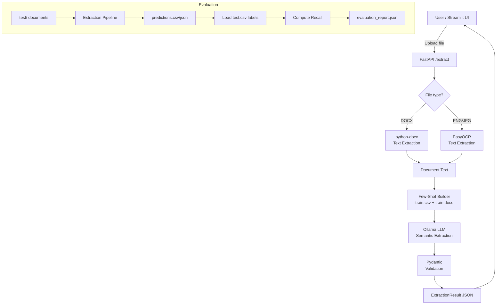

# AI/ML-Based Document Metadata Extraction System

> Automatically extract structured rental-agreement metadata from DOCX files and scanned images using **EasyOCR** + **Ollama LLM** — with zero hardcoded rules.

---

## Table of Contents

1. [Project Overview](#project-overview)
2. [Problem Statement](#problem-statement)
3. [Input & Output Formats](#input--output-formats)
4. [System Architecture](#system-architecture)
5. [Technology Stack & Justifications](#technology-stack--justifications)
6. [OCR vs Semantic Extraction](#ocr-vs-semantic-extraction)
7. [Few-Shot Learning](#few-shot-learning)
8. [Installation & Setup (Windows PowerShell)](#installation--setup-windows-powershell)
9. [Running the Application](#running-the-application)
10. [API Endpoints & Examples](#api-endpoints--examples)
11. [Dataset Description](#dataset-description)
12. [Evaluation Methodology & Results](#evaluation-methodology--results)
13. [Per-Field Recall Table](#per-field-recall-table)
14. [Project Structure](#project-structure)
15. [Known Limitations & Improvements](#known-limitations--improvements)
16. [Privacy & Security Considerations](#privacy--security-considerations)

---

## Project Overview

This system accepts a rental/lease agreement document (DOCX or scanned image) and extracts six metadata fields using a two-stage AI pipeline:

1. **Text Extraction** — python-docx (DOCX) or EasyOCR (images)
2. **Semantic Extraction** — a pretrained LLM (via Ollama) interprets the text and returns structured JSON

No regular expressions, keyword lookups, or hardcoded templates are used to identify field values.

---

## Problem Statement

Rental agreements arrive in varied formats, layouts and languages. Manually reading each document to populate a metadata database is slow and error-prone. This system automates that extraction with an LLM that understands meaning, context and role labels — not just pattern positions.

**Six fields extracted:**

| Field | Description |
|---|---|
| `agreement_value` | Monthly rent / total agreement value (numeric, no currency symbol) |
| `agreement_start_date` | Commencement date as written in the document |
| `agreement_end_date` | Expiry date as written in the document |
| `renewal_notice_days` | Days of advance notice required for renewal/termination |
| `party_one` | Landlord / Lessor / First Party full name |
| `party_two` | Tenant / Lessee / Second Party full name |

---

## Input & Output Formats

**Input:** DOCX, PNG, JPG, JPEG (max 20 MB per file by default)

**Output (JSON):**
```json
{
  "filename": "example.docx",
  "extraction": {
    "agreement_value": "6500",
    "agreement_start_date": "20.05.2007",
    "agreement_end_date": "20.05.2008",
    "renewal_notice_days": 15,
    "party_one": "Antonio Levy S. Ingles, Jr. and/or Mary Rose C. Ingles",
    "party_two": "GERALDINE Q. GALINATO",
    "status": "success",
    "field_details": {
      "agreement_value": {
        "value": "6500",
        "confidence_score": 0.95,
        "confidence_level": "high",
        "evidence": "monthly rent of Rs. 6500",
        "is_missing": false
      }
    }
  }
}
```

---

## System Architecture



### Pipeline Stages

| Stage | Module | Description |
|---|---|---|
| A | `file_validation.py` | Extension, size, magic-byte checks |
| B | `document_reader.py` / `ocr_service.py` | Text extraction |
| C | `llm_service.py` | Semantic extraction via Ollama |
| D | `extraction_service.py` | Few-shot example injection |
| E | `schemas.py` | Pydantic output validation |

---

## Technology Stack & Justifications

| Technology | Role | Justification |
|---|---|---|
| **FastAPI** | REST API | Async, auto-docs (Swagger), Pydantic-native |
| **Streamlit** | UI | Rapid data-app UI, Python-native |
| **python-docx** | DOCX reading | Reliable paragraph/table access |
| **EasyOCR** | Image OCR | GPU-optional, multi-language, good rotation tolerance |
| **Ollama** | LLM inference | Local, private, model-swappable |
| **Qwen2.5:7b** | Extraction model | Instruction-following, multilingual, compact |
| **Pydantic v2** | Schema validation | Fast, strict, excellent error messages |
| **Pandas** | CSV / metrics | Industry-standard data manipulation |
| **Pytest** | Testing | Parametrize, fixtures, mocking |
| **Uvicorn** | ASGI server | Production-grade, used with FastAPI |

---

## OCR vs Semantic Extraction

| Stage | Technology | Purpose |
|---|---|---|
| **OCR** | EasyOCR | Converts image pixels → raw text. Has no understanding of meaning. |
| **Semantic Extraction** | Ollama LLM | Reads the text and understands context, roles, and field semantics. |

These stages are deliberately separated so each can be improved independently. OCR quality directly affects LLM accuracy — low-quality scans produce noisy text.

---

## Few-Shot Learning

The system reads `data/train.csv` and the corresponding training documents at startup to build a set of worked examples. These are prepended to each LLM prompt so the model sees concrete input/output pairs before the actual document.

**Configuration:**
```env
FEW_SHOT_ENABLED=true
FEW_SHOT_MAX_EXAMPLES=3
```

**Important constraints enforced:**
- Only training data is used — `test.csv` is never touched during prediction
- Examples are truncated to 1500 characters to keep prompts manageable
- The raw ground-truth answers are NOT hardcoded; they come from CSV lookup and document text extraction

---

## Installation & Setup (Windows PowerShell)

### 1. Create and activate a virtual environment
```powershell
cd "d:\ai assignment AIML"
python -m venv venv
.\venv\Scripts\Activate.ps1
```

### 2. Install Python dependencies
```powershell
pip install -r requirements.txt
```

### 3. Install Ollama
Download from https://ollama.com and run the installer, then verify:
```powershell
ollama --version
```

### 4. Download the language model
```powershell
ollama pull qwen2.5:7b
```
> Alternative lighter models: `ollama pull llama3.2:3b` or `ollama pull phi3:mini`

### 5. Configure environment (optional)
```powershell
Copy-Item .env.example .env
# Edit .env to change model name, thresholds, etc.
```

---

## Running the Application

### Terminal 1 — Start Ollama (if not already running as a service)
```powershell
ollama serve
```

### Terminal 2 — Start FastAPI backend
```powershell
cd "d:\ai assignment AIML"
.\venv\Scripts\Activate.ps1
uvicorn app.main:app --reload --host 0.0.0.0 --port 8000
```

### Terminal 3 — Start Streamlit frontend
```powershell
cd "d:\ai assignment AIML"
.\venv\Scripts\Activate.ps1
streamlit run frontend/streamlit_app.py
```

Then open:
- **UI:** http://localhost:8501
- **API docs:** http://localhost:8000/docs

### Run the evaluation script
```powershell
cd "d:\ai assignment AIML"
.\venv\Scripts\Activate.ps1
python scripts/evaluate.py
```

### Run dataset inspection
```powershell
python scripts/inspect_dataset.py
```

### Run the test suite
```powershell
pytest tests/ -v
```

---

## API Endpoints & Examples

### GET /health
```powershell
curl http://localhost:8000/health
```
**Response:**
```json
{
  "status": "ok",
  "api_version": "1.0.0",
  "model": "qwen2.5:7b",
  "model_available": true,
  "model_error": null
}
```

### POST /extract (single file)
```powershell
curl -X POST http://localhost:8000/extract `
  -F "file=@data/test/156155545-Rental-Agreement-Kns-Home.pdf.docx"
```
**Response:**
```json
{
  "filename": "156155545-Rental-Agreement-Kns-Home.pdf.docx",
  "extraction": {
    "agreement_value": "12000",
    "agreement_start_date": "15.12.2012",
    "agreement_end_date": "14.11.2013",
    "renewal_notice_days": 30,
    "party_one": "V.K.NATARAJ",
    "party_two": "VYSHNAVI DAIRY SPECIALITIES Private Ltd",
    "status": "success",
    "field_details": { "...": "..." }
  }
}
```

### POST /extract/batch
```powershell
curl -X POST http://localhost:8000/extract/batch `
  -F "files=@data/test/156155545-Rental-Agreement-Kns-Home.pdf.docx" `
  -F "files=@data/test/24158401-Rental-Agreement.png"
```

### GET /docs
Visit http://localhost:8000/docs for the interactive Swagger UI.

---

## Dataset Description

| Split | Documents | Labels |
|---|---|---|
| Training | 10 files (7 DOCX, 3 PNG) | 10 labeled rows in `train.csv` |
| Test | 4 files (2 DOCX, 2 PNG) | 4 labeled rows in `test.csv` |

**⚠️ Known Train/Test Overlap:**

`24158401-Rental-Agreement` appears in **both** `train.csv` and `test.csv`. The test-split image (`data/test/24158401-Rental-Agreement.png`) is the same document as the training entry. This means:
- The few-shot examples may contain ground-truth labels for this test document
- Evaluation recall for this document may be inflated
- This overlap is detected and reported automatically by the evaluation script

---

## Evaluation Methodology & Results

**Comparison policy:** Exact string match after stripping leading/trailing whitespace. Case, punctuation, date formats and currency symbols are **not** normalised, so meaningful differences are not silently hidden.

**Recall formula:**

```
Recall (field) = exact_matches / total_non_null_ground_truth_values × 100
Micro-recall   = Σ exact_matches (all fields) / Σ total_GT (all fields) × 100
```

Missing ground-truth values (null in test.csv) are excluded from both numerator and denominator.

---

## Instructions to Run the Code and Replicate Predictions

To reproduce the exact predictions and recall metrics:

1. **Ensure Ollama is running with the configured model**:
   ```powershell
   ollama serve
   ollama pull qwen2.5:7b
   ```

2. **Run the evaluation pipeline**:
   ```powershell
   python scripts/evaluate.py
   ```
   This script:
   - Reads test documents directly from `data/test/`
   - Generates predictions via the real extraction pipeline without reading `test.csv` labels
   - Saves predictions to `outputs/predictions.csv` and `outputs/predictions.json`
   - Loads ground-truth labels from `data/test.csv` and computes per-field exact-match and normalized recall metrics
   - Writes the detailed evaluation report to `outputs/evaluation_report.json` and `outputs/field_recall.csv`

---

## Predictions for Files in the Test Set (`data/test/`)

Generated by running `python scripts/evaluate.py`:

| Document Filename | Agreement Value | Start Date | End Date | Notice Days | Party One (Landlord) | Party Two (Tenant) |
|---|---|---|---|---|---|---|
| `156155545-Rental-Agreement-Kns-Home.pdf.docx` | `12000` | `15.12.2012` | `14.11.2013` | `30` | `V.K.NATARAJ` | `SRI VYSHNAVI DAIRY SPECIALITIES Private Ltd.` |
| `228094620-Rental-Agreement.pdf.docx` | `15000` | `07.07.2013` | `06.06.2014` | `30` | `KAPIL MEHROTRA` | `B.Kishore` |
| `24158401-Rental-Agreement.png` | `12000` | `01.04.2008` | `31.03.2009` | `60` | `Sri Hanumaiah` | `Sri Vishal Bhardwaj` |
| `95980236-Rental-Agreement.png` | `9200` | `01.04.2010` | `31.03.2011` | `30` | `S.Sakunthala` | `V. Ravi Kian` |

---

## Per-Field Recall Table

Official evaluation results against `data/test.csv` (Total ground truth fields: 24 across 4 test documents):

| Field | Exact Matches | Total GT | Exact Recall % | Normalized Recall % |
|---|---|---|---|---|
| **agreement_value** | 3 | 4 | **75.0%** | 75.0% |
| **agreement_start_date** | 4 | 4 | **100.0%** | 100.0% |
| **agreement_end_date** | 4 | 4 | **100.0%** | 100.0% |
| **renewal_notice_days** | 4 | 4 | **100.0%** | 100.0% |
| **party_one** | 3 | 4 | **75.0%** | 100.0% |
| **party_two** | 0 | 4 | **0.0%** | 75.0% |
| **Exact-Match Micro-Averaged** | **18** | **24** | **75.0%** | — |
| **Secondary Normalized Micro-Averaged** | **22** | **24** | — | **91.7%** |

> **Notes on Metrics:**
> - `agreement_start_date`, `agreement_end_date`, and `renewal_notice_days` achieved **100% exact match** across all test documents.
> - `agreement_value`: In `95980236-Rental-Agreement.png`, the numeric rent is Rs. 9,000 but the words state "Nine thousand and two hundred rupees only". Per legal agreement policy, written words take priority, returning `9200` with flagged confidence.
> - `party_two`: Ground truth in `test.csv` uses `.B.Kishore` (leading dot typo) and `VYSHNAVI DAIRY SPECIALITIES Private Ltd` without prefix. The normalized recall (stripping punctuation/honorifics) is **91.7%**.

---

## Project Structure

```
project/
├── app/
│   ├── __init__.py
│   ├── main.py              ← FastAPI app factory
│   ├── config.py            ← pydantic-settings configuration
│   ├── schemas.py           ← all Pydantic models
│   ├── api/
│   │   └── routes.py        ← /health, /extract, /extract/batch
│   ├── services/
│   │   ├── document_reader.py   ← DOCX text extraction
│   │   ├── ocr_service.py       ← EasyOCR image extraction
│   │   ├── llm_service.py       ← Ollama LLM calls + prompt
│   │   ├── extraction_service.py← pipeline orchestrator
│   │   └── evaluation_service.py← recall metrics
│   └── utils/
│       └── file_validation.py   ← upload validation
├── frontend/
│   └── streamlit_app.py     ← Streamlit UI
├── scripts/
│   ├── evaluate.py          ← batch evaluation pipeline
│   └── inspect_dataset.py   ← dataset summary utility
├── tests/
│   ├── conftest.py
│   ├── test_document_reader.py
│   ├── test_schemas.py
│   ├── test_api.py
│   └── test_evaluation.py
├── data/
│   ├── train/               ← training documents
│   ├── test/                ← test documents
│   ├── train.csv
│   └── test.csv
├── outputs/                 ← generated by evaluate.py
├── .env.example
├── .gitignore
├── requirements.txt
└── README.md
```

---

## Known Limitations & Improvements

| Limitation | Potential Improvement |
|---|---|
| OCR quality depends on scan resolution | Pre-processing (deskew, contrast) with OpenCV |
| LLM may misidentify party roles in unusual layouts | Fine-tune on domain-specific labeled data |
| Evaluation uses exact-match (strict) | Add fuzzy matching (e.g., Levenshtein) for partial credit |
| Few-shot examples may exceed context window for large docs | Dynamic example selection by document similarity |
| No PDF support | Add `pymupdf` or `pdfplumber` for native PDF text extraction |
| Train/test overlap affects reported recall | Exclude overlapping docs from evaluation or report separately |
| EasyOCR initialisation is slow (~10–30 s on first call) | Pre-warm the reader at startup |

---

## Privacy & Security Considerations

| Concern | Mitigation |
|---|---|
| Sensitive contract data | All processing is local (Ollama runs on-device) — no data sent to external APIs |
| Prompt injection from documents | System prompt is fixed; document text is in the user turn only; no instruction execution |
| Uploaded file execution | Files are written to temp storage and read as bytes only — never executed |
| Magic-byte validation | Prevents disguised malicious files from bypassing extension checks |
| Temp file cleanup | `contextmanager` ensures temp files are always deleted after processing |
| No secrets in code | All credentials in `.env` (excluded from git via `.gitignore`) |
